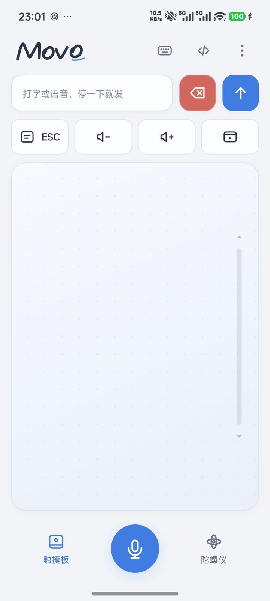
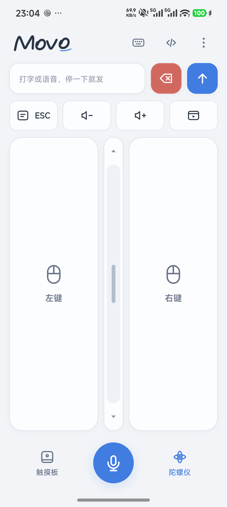
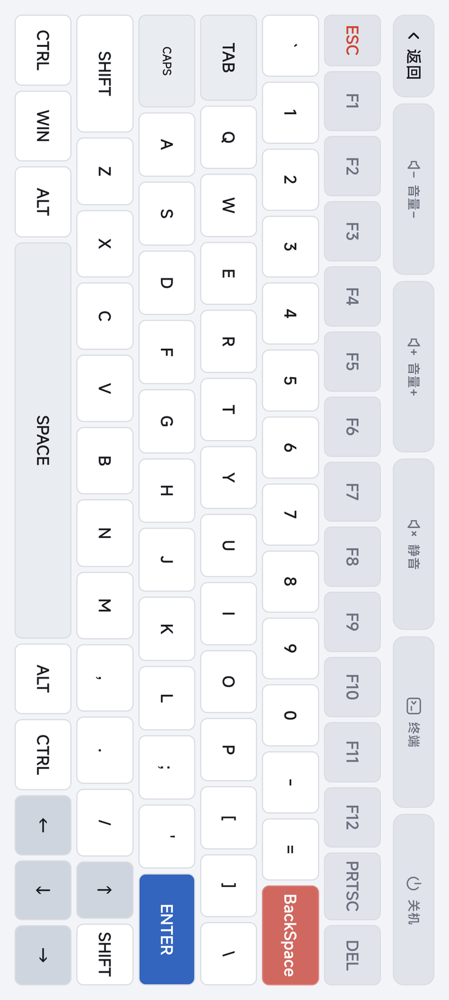
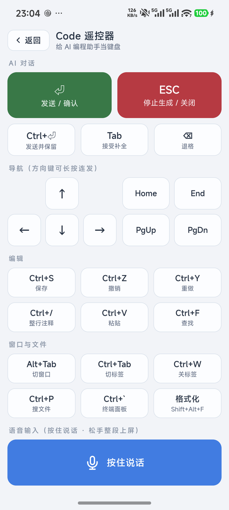

<div align="center">


# Movo

**把手机变成电脑的触控板、键盘和语音输入设备**

Windows 服务端 + Android App · 纯局域网直连 · 数据不出内网

[下载最新版](../../releases/latest) · [快速开始](#-快速开始) · [故障排查](#-故障排查)

</div>

---

| 触控板 | 陀螺仪空鼠 | 键盘 | Code 遥控器 |
|:---:|:---:|:---:|:---:|
|  |  |  |  |

## ✨ 功能

### 🖱 触控板

- 单指移动 · 双指滚动 · **双指捏合缩放**（等同 Ctrl + 滚轮）· 三指拖拽
- 右缘滚轮条：跟手滚动，两端箭头长按连续滚；左手模式可换到左边
- **陀螺仪空鼠**：拿起手机指哪打哪，屏幕左右两块区域就是鼠标左右键
- 快捷输入条：打字停顿自动上屏（停顿时长可调），退格长按 1 秒清空
- 快捷键栏：ESC、音量 ±（按住连调）、可自定义的网站/应用启动键

### ⌨️ 键盘

- 全键盘 + F1~F12 + PRTSC / DEL + 方向键，按键带按压动效和震动
- Ctrl / Shift / Alt / Win **长按 0.6 秒锁定**，点一下解锁，不用按住不放
- 顶栏系统键：音量 / 亮度（硬件背光优先）/ **终端** / **关机**（长按 1 秒 + 进度条防误触）

### 🤖 Code 遥控器

给 AI 编程助手当键盘：发送/确认、停止生成、Tab 补全、方向导航、
Ctrl+S / Ctrl+Z / 整行注释这些高频组合键一键直达，
底部**全宽语音话筒**按住说话，松手整段文字进聊天框。

### 🎙 语音输入（触控板 / Code 页通用）

按住说话，手机屏上实时出字，松手整段打到电脑光标处。
识别跑在电脑端：**火山豆包流式识别 2.0**（首个中间结果约 0.7 秒，内置编程热词，
中英混说的 `useState` / `TypeScript` 这类专名基本全对）；未配置 Key 或断网时
自动回落**本地 SenseVoice** 离线识别。详见[语音识别说明](#-语音识别)。

### 🔒 稳定性设计

- **闲置 61 秒自动休眠连接，手指一碰立即唤醒**：省电，断连永远可预期
- 所有按键「按下—松开」配对记账：断线、休眠、切后台自动复位，**不会卡键**
- 释放前先查真实键状态，**不会凭空冒出右键菜单**；中键 / 左键看门狗超时兜底
- 自签名 HTTPS 加密，数据只在局域网内流转
- 中英文双语 + 日夜主题，全部设置记住选择

## 🚀 快速开始

> 手机和电脑连**同一个局域网**（同一个路由器 / WiFi）。

| 下载（[Releases](../../releases/latest)） | 放到哪 | 说明 |
|---|---|---|
| `MovoServer.exe` | Windows 电脑 | 单文件免安装，双击即运行，无需 Python |
| `Movo-v2.0.0.apk` | Android 8.0+ 手机 | 安装后打开，第一次会引导填地址 |

1. **电脑**：双击 `MovoServer.exe` → 浏览器自动打开欢迎页（可选填语音 API Key）→
   关掉页面，服务留在系统托盘继续跑
2. **手机**：打开 Movo → 填电脑地址（如 `192.168.31.12:5888`）→ 首次连接信任自签证书
3. 完成，手机屏幕就是触控板

> - 🔥 首次启动被 Windows 防火墙拦截时选「允许访问」，或手动放行 5888 端口
> - 🛡 需要控制管理员权限的程序（如任务管理器）时，以管理员身份运行服务端
> - 🔁 之后随时双击 exe 或点托盘菜单「设置 / API Key」回到欢迎页

不想装 App？手机浏览器直接打开 `https://<电脑IP>:5888/touchpad` 就能用（App 的意义在于全屏、保活、原生震动）。

<details>
<summary><b>源码运行</b></summary>

```bash
# Windows / macOS / Linux，Python 3.11+
pip install -r requirements.txt
python server.py            # 服务端 5888 + 配置页 5889 + 系统托盘

# 可选：开机自启
install-autostart.bat       # 往启动文件夹放一个静默启动脚本
```

</details>

## 🎙 语音识别

识别在**电脑端**完成，手机只采音（16kHz PCM 走 socket）：

| 场景 | 引擎 | 体验 |
|---|---|---|
| 填了 API Key | 火山豆包流式识别 2.0 | ~0.7s 出中间结果 · 编程热词 · 带标点 · 中英混说准确 |
| 没填 / 断网 | 本地 SenseVoice（sherpa-onnx） | 完全离线 · 英文专名容易错 |

- API Key 在欢迎页粘贴，「**测试连接**」会真实握手校验（能区分 Key 无效 / 未开通 / 网络不通），保存即热生效
- Key 保存在本机 `voice_config.json`，**安装包不含任何密钥**，按你自己的火山账号计费
- 本地离线模型不进安装包；需要时下载到 `models/`（地址见 `.gitignore`），只填 Key 也能用语音

## ⚙️ App 设置

| 设置 | 范围 |
|---|---|
| 电脑服务地址 | `IP:端口` |
| 触控板灵敏度 | 1 ~ 10 |
| 空鼠灵敏度 | 0.1 ~ 5 |
| 输入停顿自动发送 | 0.3 ~ 3 秒 |
| 操作手 | 左手 / 右手（滚轮条换边） |
| 界面语言 | 中文 / English |

## 🛠 构建

```bash
# Windows 服务端 → dist/MovoServer.exe（PyInstaller 单文件）
build_exe.bat

# Android App（需 Android SDK + Gradle 8.9）
cd android && gradlew.bat assembleDebug
```

<details>
<summary><b>项目结构</b></summary>

```
├── server.py            服务端入口（Flask + flask-socketio + pynput，端口 5888，托盘）
├── welcome_server.py    本地配置页 127.0.0.1:5889（欢迎页 / API Key）
├── web_app.py           路由：/touchpad /k /controller /voice /healthz
├── mouse_service.py     鼠标注入 + 按下状态记账 + 看门狗
├── keyboard_service.py  键盘注入（无竞态点按、组合键、多媒体键）
├── system_service.py    亮度（DDC/CI → gamma 兜底）/ 终端 / 关机
├── voice_service.py     语音调度（云端豆包 ↔ 本地 SenseVoice）
├── voice_volc.py        火山豆包流式识别客户端（SAUC v3 协议）
├── templates/           页面模板（改 HTML 免重启）
├── static/js/link.js    连接生命周期（休眠 / 唤醒 / 心跳）
├── static/js/voice.js   按住说话（触控板 / Code 页共用）
├── static/js/i18n.js    中英文词表
└── android/             Android WebView 壳（原生震动、保活、开机自启）
```

</details>

## 🧯 故障排查

| 现象 | 处理 |
|---|---|
| 物理键盘行为怪（像按着 Ctrl） | `python release_keys.py` 释放卡键 |
| 鼠标点击失灵 | `python release_mouse.py`（通常是中键卡住） |
| 屏幕停在调暗状态 | `python reset_brightness.py` |
| 手机连不上 | 确认同网段 → `ping 电脑IP` → 检查防火墙 5888 → 试 `restart-movo.bat` |
| 抓调试日志 | 设环境变量 `MOVO_DIAG=1` 后重启，日志写 `_diag.log`（默认关闭） |

## 🙏 致谢

起源于上游开源项目 [cornradio/AirMouse](https://github.com/cornradio/AirMouse)，在此基础上深度改造：
重做三页 UI 与日夜主题、重写连接生命周期、修复卡键与幽灵右键、整合语音输入、
加入双指捏合缩放、重做 Android 原生壳、补上双击即用的欢迎配置页。
完整改动见 [CHANGELOG.md](CHANGELOG.md)。
