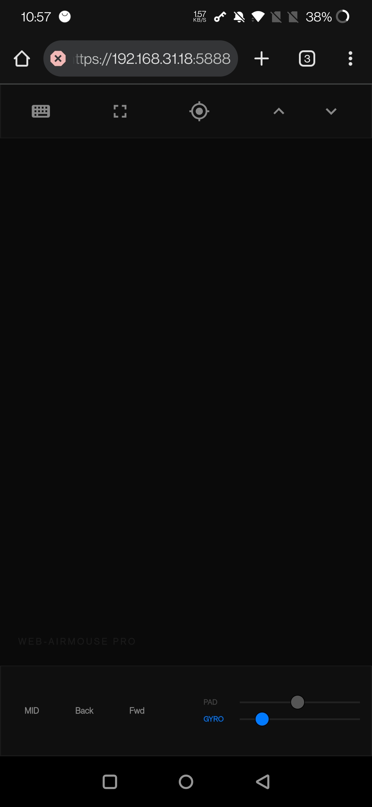
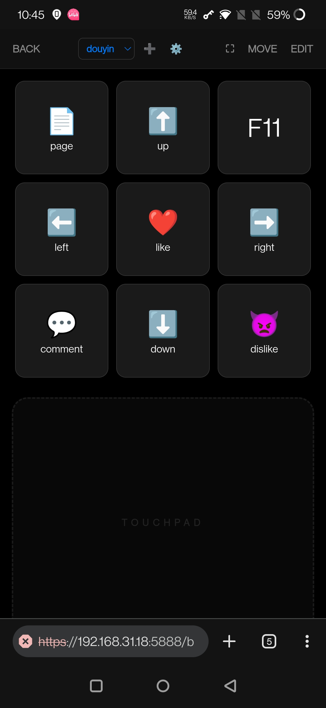

<div align="center">

# Movo

**把手机变成电脑的触控板、键盘和语音输入设备**

`Windows 服务端` + `Android App`（或任意浏览器）· 纯局域网直连 · 数据不出内网

</div>

---

<table>
  <tr>
    <td></td>
    <td></td>
    <td></td>
  </tr>
</table>

## ✨ 它能做什么

### 🖱 触控板 `/touchpad`

- **手势**：单指移动 · 双指滚动 · 双指捏合缩放（Ctrl + 滚轮）· 三指拖拽
- **陀螺仪空鼠**：拿起手机指哪打哪，左右两块区域就是鼠标左右键
- **右缘滚轮条**：条身滑动跟手滚动，两端箭头长按连续滚
- **左手 / 右手模式**：设置里一键把滚轮条换到触摸板左边
- **快捷输入条**：打字停顿一下自动发送到电脑（停顿时长可调）
- **语音输入**：按住底部圆钮说话，手机屏上实时出字，松手整段打到光标处
- **快捷键栏**：ESC、音量 ±（支持按住连调）
- **日 / 夜间主题**：三页共用，记住选择

### ⌨️ 键盘 `/k`

- 全键盘 + F1~F12 + PRTSC / DEL；Ctrl / Shift / Alt / Win **长按 0.6 秒锁定**，点一下解锁
- 按键按下放大动效 + 震动反馈；退格键长按 1 秒清空输入框
- **顶栏系统功能键**：
  - 音量 − / 音量 + / 静音（按住连调）
  - 亮度 − / 亮度 +（优先显示器硬件背光，不支持时自动退回软件调光）
  - **终端**：一键在电脑上打开 Windows Terminal / PowerShell
  - **关机**：需长按 1 秒 + 红色进度条填满才触发，防误触

### 🤖 Code 遥控器 `/controller`

给 AI 编程助手当键盘用：常用代码符号、`Enter` / `Tab` / `Esc`、组合键一键直达，
底部是**全宽语音话筒**——按住说话，松手整段文字进聊天框，不用在手机上戳键盘。

### 🔒 稳定性

- **闲置 61 秒自动休眠连接，手指一碰立即唤醒**：省电，且断连永远是可预期的
- 按键 / 鼠标全部「按下—松开」配对记账：断线、休眠、切后台都会自动复位，**不会卡键**
- 中键 / 左键看门狗超时兜底；释放前先查真实键状态，**不会凭空冒出右键菜单**
- 自签名 HTTPS，流量加密，所有数据只在局域网内流转

## 🚀 快速开始

> 前提：手机和电脑连在**同一个局域网**（同一个路由器 / WiFi）。

### 方式一：下载 Release（推荐）

到 [**Releases**](../../releases) 下载两个文件：

| 文件 | 放在哪 | 说明 |
|---|---|---|
| `MovoServer.exe` | Windows 电脑 | 双击运行，托盘出现 Movo 图标即已就绪 |
| `Movo-v2.0.0.apk` | Android 手机 | 安装后打开，第一次会引导填电脑地址 |

1. **电脑**：双击 `MovoServer.exe`，会自动打开欢迎页——里面可以填你自己的
   **火山引擎「豆包语音识别」API Key**（不填也能用，语音走本地离线模型，准确率低一些）。
   关掉页面后服务留在系统托盘继续运行。
2. **手机**：打开 Movo，填电脑地址（如 `192.168.31.12:5888`），首次连接信任自签证书。
3. 完成，手机屏幕就是触控板。

> 之后随时双击 exe 或点托盘菜单「设置 / API Key」都能回到这个页面。
> API Key 走你自己的账号计费，**安装包里不包含任何密钥**。

> ⚠️ 首次启动若被 Windows 防火墙拦截，选「允许访问」，或手动放行 5888 端口。
> 需要控制管理员权限的程序（如任务管理器）时，请以管理员身份运行服务端。

### 方式二：浏览器直连（零安装）

手机浏览器打开 `https://<电脑IP>:5888/touchpad`，功能完全一样。
App 的意义在于：全屏、保活、原生震动马达、记住地址。

### 方式三：源码运行

```bash
# Windows / macOS / Linux，Python 3.11+
pip install -r requirements.txt
python server.py              # 托盘 + 服务端（5888）+ 配置页（5889）

# 可选：开机自启
install-autostart.bat         # 往启动文件夹放一个静默启动脚本
```

手机访问 `https://<电脑IP>:5888/touchpad`。

## 🎙 语音识别说明

识别跑在**电脑端**，手机只负责采音（16kHz PCM 经 socket 推过去）：

| 场景 | 引擎 | 特点 |
|---|---|---|
| 已填 API Key | 火山豆包流式识别 2.0 | 首个中间结果约 0.7 秒，内置编程热词，中英混说专名基本全对，带标点 |
| 未填 / 断网 | 本地 SenseVoice（sherpa-onnx） | 完全离线，RTF ≈ 0.03；英文专名容易错 |

本地模型不进安装包，需要时手动下载到 `models/` 目录（见 `.gitignore` 里的下载地址）。
**只填 API Key 就能用语音**，不必下模型。

## ⚙️ 设置项（App 内）

| 设置 | 说明 |
|---|---|
| 电脑服务地址 | `IP:端口`，如 `192.168.31.12:5888` |
| 触控板灵敏度 | 1 ~ 10 |
| 空鼠（陀螺仪）灵敏度 | 0.1 ~ 5 |
| 输入停顿后自动发送 | 0.3 ~ 3 秒 |
| 操作手 | 右手 = 滚轮条在右边；左手 = 换到左边 |
| 界面语言 | 中文 / English |

## 🛠 构建

```bash
# Windows 服务端 → dist/MovoServer.exe（PyInstaller 单文件）
build_exe.bat

# Android App（需 Android SDK + Gradle 8.9）
cd android && gradlew.bat assembleDebug
# 产物：android/app/build/outputs/apk/debug/app-debug.apk
```

## 📁 结构

```
├── server.py            服务端入口（Flask + flask-socketio + pynput，端口 5888，托盘）
├── welcome_server.py    本地配置页 127.0.0.1:5889（欢迎页 / API Key，双击 exe 时打开）
├── web_app.py           路由：/touchpad /k /controller /voice /healthz
├── mouse_service.py     鼠标注入 + 按下状态记账 + 看门狗
├── keyboard_service.py  键盘注入（无竞态点按、组合键、多媒体键）
├── system_service.py    亮度（DDC/CI → gamma 兜底）/ 终端 / 关机
├── voice_service.py     语音调度（云端豆包 ↔ 本地 SenseVoice）
├── voice_volc.py        火山豆包流式识别客户端（SAUC v3 协议）
├── templates/           四个页面（改 HTML 免重启，刷新即生效）
├── static/js/link.js    三页共用连接生命周期（休眠 / 唤醒 / 心跳）
├── static/js/voice.js   两页共用的按住说话
├── static/js/i18n.js    中英文词表
└── android/             Android WebView 壳（原生震动、保活、开机自启）
```

## 🧯 故障排查

| 现象 | 处理 |
|---|---|
| 物理键盘行为怪（像按着 Ctrl） | `python release_keys.py` 释放所有卡键 |
| 鼠标点击失灵 | `python release_mouse.py`（通常是中键卡住） |
| 屏幕停在调暗状态 | `python reset_brightness.py` |
| 手机连不上 | 确认同网段；`ping 电脑IP`；检查防火墙 5888 |
| 想抓调试日志 | 设环境变量 `MOVO_DIAG=1` 后重启，日志写 `_diag.log`（默认关闭） |
| 服务起不来 | `netstat -ano \| findstr 5888` 看端口占用；或双击 `restart-movo.bat` |

## 🙏 致谢

起源于上游开源项目 [cornradio/AirMouse](https://github.com/cornradio/AirMouse)，在此基础上深度改造：
整体重做三页 UI 与日夜主题、重写连接生命周期（休眠 / 唤醒）、修复卡键与幽灵右键、
新增键盘页系统功能键与左手模式、把语音输入整合进触控板与 Code 页、
加入双指捏合缩放、重做 Android 原生壳与保活、补上双击即用的欢迎配置页。

详细改动见 [CHANGELOG.md](CHANGELOG.md)。
